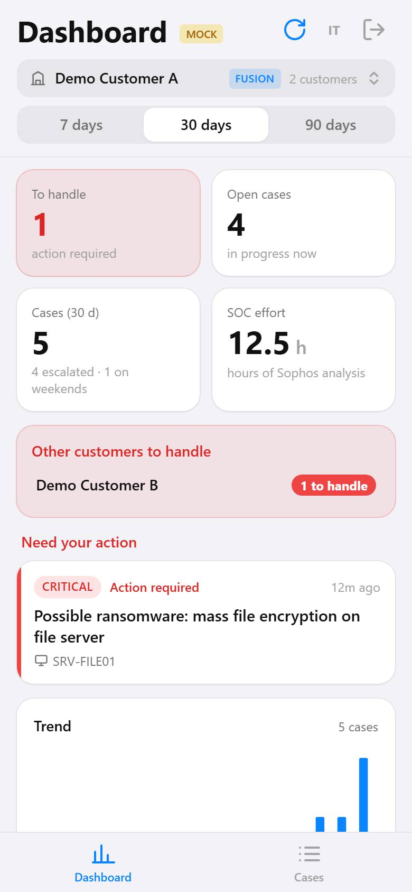
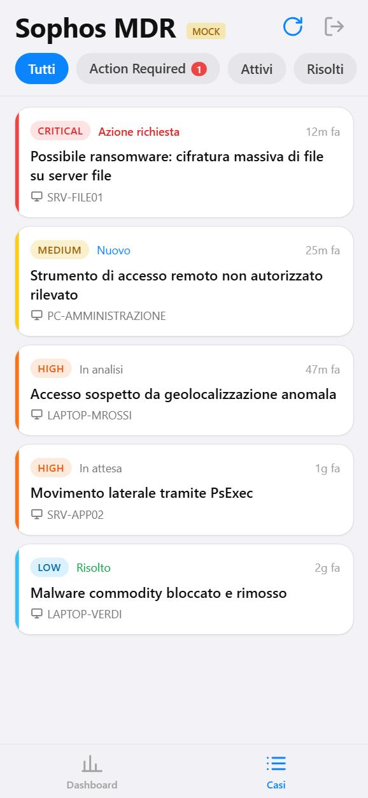
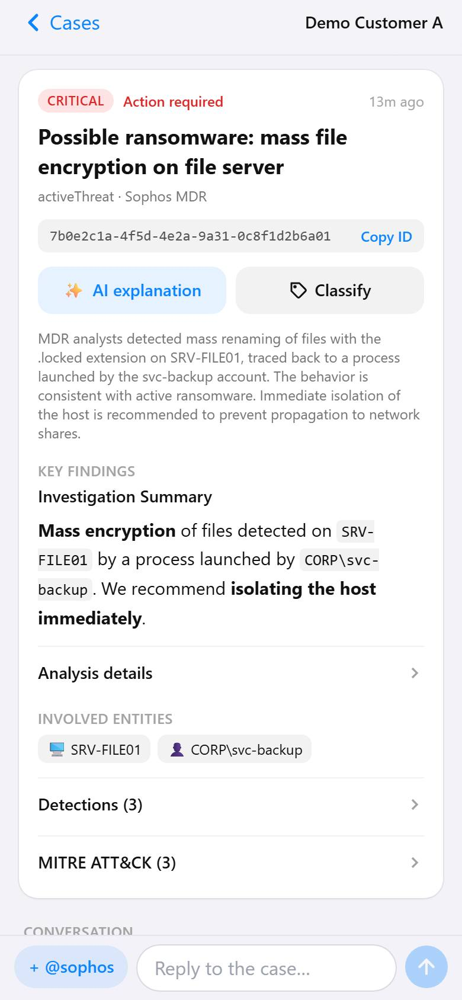
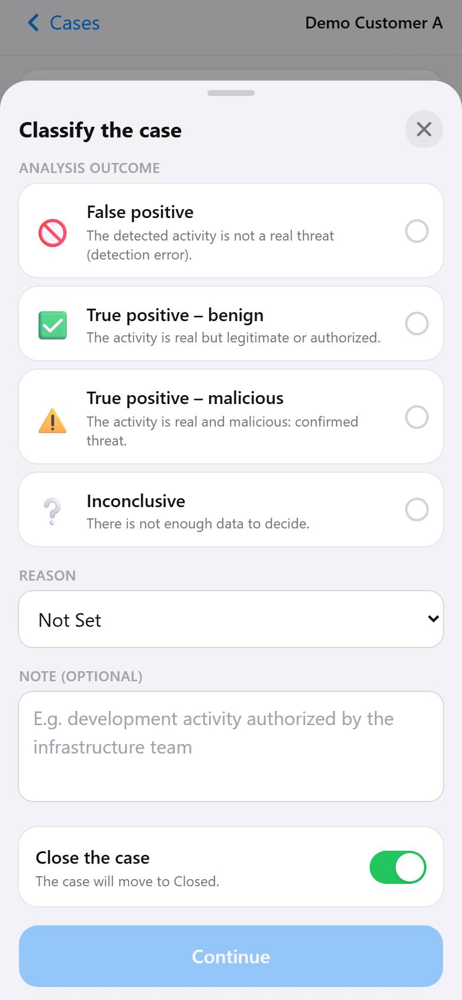
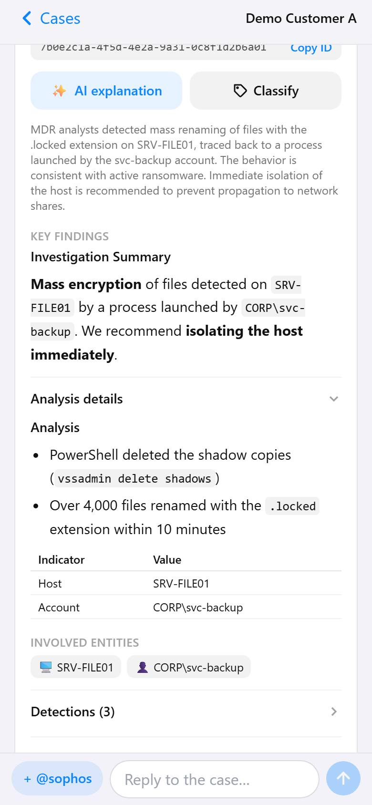
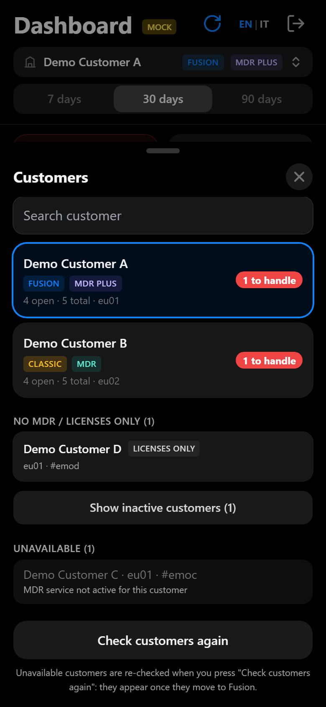
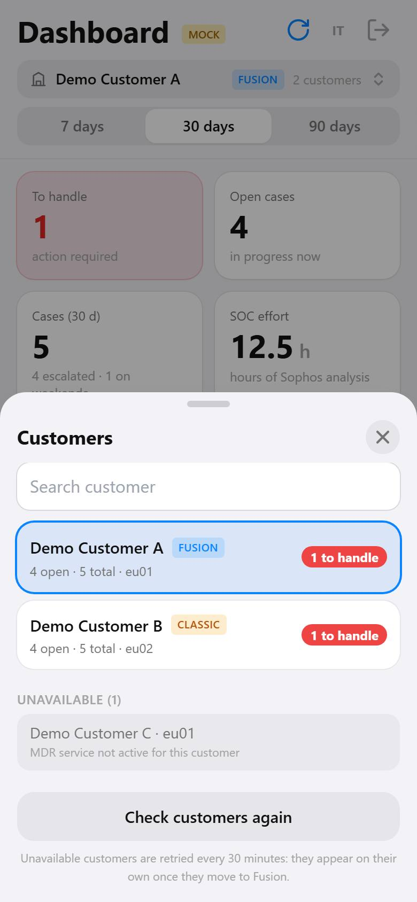
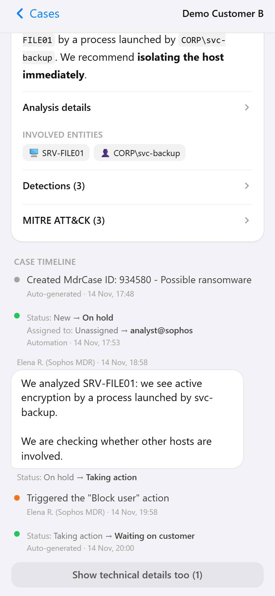

# Sophos MDR Mobile

A mobile-first PWA (designed for iPhone/Safari) to browse, monitor and answer **Sophos MDR** cases through Sophos' Cases GraphQL API and the Sophos Central REST API. Node/Express backend (BFF) + React/Vite/Tailwind frontend, shipped in **a single container**. Sophos secrets stay in the backend; the OAuth2 token is cached in memory and renewed before it expires. The UI is available in English and Italian.

> **Disclaimer:** this is an independent, community project. It is **not affiliated with, endorsed by, or sponsored by Sophos Ltd.** Sophos, Sophos Central, Sophos Fusion and Sophos MDR are trademarks of Sophos Ltd. The app only uses the publicly documented Sophos APIs with your own credentials.

Features:
- **Dashboard** (home): cases to handle / open, cases and SOC effort hours over the period (7/30/90 days), trend, severity and analysis outcome (% false positives).
- Case list with filters and pull-to-refresh; case detail with key findings (Markdown), detections, MITRE techniques, involved hosts and users.
- **AI explanation** (Sophos AI, English only): case summary and per-detection analysis.
- **Case classification**: verdict (false positive, benign/malicious true positive, inconclusive), reason, note and closing, with explicit confirmation.
- Chat with the analysts and comment posting (`@sophos` shortcut), PIN login, dark mode, demo mode with fake data.
- **Multi-tenant** (Partner accounts): customer picker with a portfolio view (cases to handle per customer). Customers already on Fusion get every feature; customers still on **classic Sophos Central** are **read-only** (cases, detections, MITRE, entities and activity timeline, but no comments, classification or AI). Unreachable customers (not delegated / not on Fusion) are listed with the reason and re-checked every 30 minutes or on demand.
- **Bilingual UI** (English / Italian): follows the browser language, switchable in the app or with `?lang=en` / `?lang=it`.

## Screenshots

Demo mode (`MOCK_MODE=true`): all data is made up.

<table>
  <tr>
    <td align="center"><br><sub>Dashboard</sub></td>
    <td align="center"><br><sub>Case list</sub></td>
    <td align="center"><br><sub>Case detail</sub></td>
  </tr>
  <tr>
    <td align="center"><br><sub>Classification</sub></td>
    <td align="center"><br><sub>AI explanation</sub></td>
    <td align="center"><br><sub>Dark mode</sub></td>
  </tr>
  <tr>
    <td align="center"><br><sub>Customer picker</sub></td>
    <td align="center"><br><sub>Classic case timeline (read-only)</sub></td>
    <td></td>
  </tr>
</table>

## Quick start (Docker)

```bash
cp .env.example .env      # set APP_ACCESS_PIN and SESSION_SECRET; MOCK_MODE=true for the demo
docker compose up -d --build
```

By default the app listens on `127.0.0.1:3456`. To use it on an iPhone you need **HTTPS** (`Secure` cookie, PWA installation): publish it behind a reverse proxy or tunnel that terminates TLS and forwards to `127.0.0.1:3456` (Caddy, nginx, Cloudflare Tunnel, etc.), with `TRUST_PROXY=true` in `.env`. The proxy must send `X-Forwarded-Proto`.

### Add to the iPhone Home Screen
Safari → Share → **Add to Home Screen**: the app opens full screen.

## Sophos credentials

Create an **API credential** in Sophos Central/Fusion and set in `.env`: `MOCK_MODE=false`, `SOPHOS_CLIENT_ID`, `SOPHOS_CLIENT_SECRET` (and `SOPHOS_TENANT_ID` only for Partner/Organization credentials).

**Multiple customers:** you can define up to 6 credentials (`SOPHOS_CLIENT_ID_2` / `SOPHOS_CLIENT_SECRET_2` …), for example a Partner credential from the Partner Dashboard. At startup the app lists the tenants visible to each credential (`whoami` and `/partner/v1/tenants`), tries Fusion first and then the classic Sophos Central Cases API for each tenant, and uses the connection that returns cases. Nothing is written to disk: in-memory caches only.

Permissions: a read-only role is enough to read cases; to **comment** and **classify/close** cases you need `Investigation:update` (and `mention_partner` for `@sophos`). For hosts and users the app reads detections (`Alert:read`); with `Agent:read` it also shows the host isolation status. Pick the role with the fewest privileges that includes these permissions and avoid administrative roles: you can read your credential's effective permissions with the `authzPermissions` query.

The backend only uses: case list/detail, comments, `updateCase` (classification/closing), evidence, detections (alerts), metrics (`caseSummaryMetrics`, `casesAggregation`) and the AI queries `generativeAICaseSummary` / `generativeAIDetectionAnalysis`.

Integration notes (endpoint `https://api.taegis.sophos.com/graphql`, headers `Authorization` + `X-Tenant-ID`):
- The `Case` type only exposes evidence IDs: detections, MITRE, hosts and users are derived from the alerts (`detectionRetrieveById`), cached for 10 minutes. Without detections (and without `Agent:read`) hosts and users are not available.
- Primary statuses are per tenant (`new`, `awaiting_sophos_assignment`, `in_progress`, `customer_action_required`, `on_hold`, `closed`): the mapping lives in `toStatus` (`server/src/services/sophosQueries.ts`).
- Sophos AI answers are English only; verdicts and reasons are read at runtime (`casePrimaryVerdicts`, `caseSecondaryVerdicts`).
- Classification writes to Sophos with a single `updateCase` (verdict, reason, note and, if requested, closed status): compatibility and requirements are validated by Sophos and the error is shown.
- Comments carry no "MDR analyst" flag: yours are recognized by an `authorId` equal to the API client id (or `SOPHOS_MY_AUTHOR_IDS`).
- The Sophos backend sometimes returns transient errors (`conn busy`) when several queries are combined: the case and its comments are separate requests, with automatic retries.
- Filters and sorting are applied by the backend (latest 300 cases), not via CQL.
- Classic Sophos Central: `{apiHost}/cases/v1/cases` (page size max 50) with `/detections`, `/impacted-entities`, `/mitre-attack-summary`; there are no comments, verdicts or AI. The timeline uses the undocumented `/activities` endpoint and may change.

## Local development

Requires Node 20+.

```bash
npm run install:all
npm run icons                 # generate the PNG icons (once)
cp .env.example .env          # MOCK_MODE=true
npm run dev:server            # API on :3456
npm run dev:web               # Vite on :5173 (/api proxy)
```

Production build without Docker: `npm run build && NODE_ENV=production npm start` (serves `web/dist`).

## `.env` variables

| Variable | Description |
|---|---|
| `APP_ACCESS_PIN` | Access PIN/password (required) |
| `SESSION_SECRET` | Cookie signing key (if empty, sessions are lost on restart) |
| `MOCK_MODE` | `true` = fake data, in-memory comments |
| `SOPHOS_CLIENT_ID` / `SOPHOS_CLIENT_SECRET` | Sophos API credentials |
| `SOPHOS_CLIENT_ID_2` / `SOPHOS_CLIENT_SECRET_2` … `_6` | Additional credentials (e.g. Partner, multi-customer) |
| `SOPHOS_TENANT_ID` | Only for Partner/Organization credentials |
| `SOPHOS_MY_AUTHOR_IDS` | authorIds to show as "yours" in the chat |
| `TRUST_PROXY` | `true` behind an HTTPS reverse proxy |
| `COOKIE_SECURE` | Default `auto` (Secure if the request is HTTPS) |
| `BIND_IP` | IP the compose file publishes the port on (default `127.0.0.1`) |
| `PORT` | Port (default 3456) |

## Security
- PIN compared in constant time, rate limit of 5 failures/15 min per IP, HMAC-signed cookie, `HttpOnly` and `SameSite=Lax`.
- API writes only accept `application/json`; strict CSP; `/api` responses are `no-store`; the service worker never caches the API.
- Do not expose the app on the Internet without an additional access layer: the PIN is the only application-level protection.
- `.env` contains secrets: never commit it (it is in `.gitignore`).

## License

[MIT](LICENSE) © 2026 gotta80
